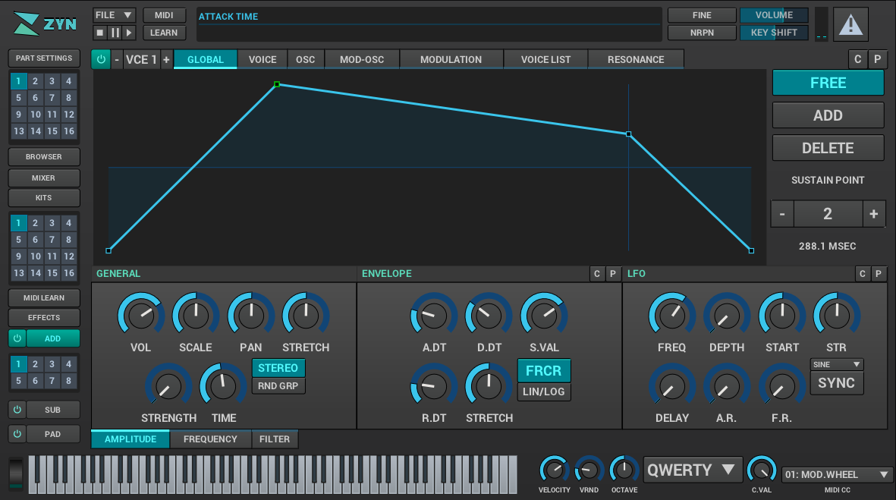

# Zynesis

Zynesis is a synthesizer plugin in **VST3** and **CLAP** formats for **Linux**
and **Windows** (x86_64), with the Zyn-Fusion editor built in. macOS (and an
Audio Unit) may follow some day.

Zynesis started as a fork of [ZynAddSubFX](https://github.com/zynaddsubfx/zynaddsubfx)
and keeps its synthesis engine, but it is now a separate project with its own
goals: one self-contained plugin for modern hosts. It is not affiliated with
or endorsed by the ZynAddSubFX project, and it does not build the standalone
ZynAddSubFX application or its LV2, VST2 and DSSI plugins, which Zynesis treats
as legacy formats. Zynesis uses its own plugin IDs, so it installs side by side
with ZynAddSubFX.



The synthesis engine offers additive, subtractive and PAD synthesis, a
waveform generator with up to 128 harmonics, analog-modeled, formant and
state-variable filters, envelopes and LFOs, a full effect rack, kits and
layered instruments, microtonal scales, and over 1100 instruments.

## Building

Both platforms build on Linux. `scripts/build.sh <platform>` produces:

```text
dist/<platform>/VST3/Zynesis.vst3    VST3 bundle
dist/<platform>/CLAP/Zynesis.clap    CLAP plugin
dist/<platform>/CLAP/Zynesis/        resources the CLAP plugin loads (keep it next to Zynesis.clap)
dist/Zynesis-<platform>-x86_64.zip   both formats
```

Each plugin carries the editor runtime, its assets, the factory banks and the
license files, so nothing else needs to be installed. CI builds both platforms
on every push (`.github/workflows/ci.yml`) and uploads them as artifacts.

### Linux

Install the dependencies (Ubuntu/Kubuntu 24.04 package names), then build:

```sh
sudo apt install build-essential bison cmake pkg-config ruby rake zip \
    libfftw3-dev libmxml-dev liblo-dev zlib1g-dev libuv1-dev \
    libx11-dev libxcursor-dev libxext-dev libxrandr-dev \
    libgl-dev libglx-dev libopengl-dev libdbus-1-dev
./scripts/build.sh linux
```

### Windows (cross-build from Linux)

Install the MinGW-w64 toolchain and the build tools, then build:

```sh
sudo apt install gcc-mingw-w64-x86-64-posix g++-mingw-w64-x86-64-posix \
    autoconf automake libtool bison cmake make pkg-config ruby rake zip curl
./scripts/build.sh windows
```

Use the `posix` threading variant of MinGW-w64. If the `win32` variant is
installed too, select `posix` with
`sudo update-alternatives --config x86_64-w64-mingw32-gcc` (and `-g++`).

On first use, `scripts/build-windows-deps.sh` downloads pinned, SHA-256
verified sources of zlib, FFTW, Mini-XML and liblo and cross-compiles them as
static libraries into `build-win-deps/prefix`. The plugins import only
Windows system DLLs.

### Options

| Variable          | Default                 | Purpose                               |
| ----------------- | ----------------------- | ------------------------------------- |
| `BUILD_DIR`       | `build-<platform>`      | CMake build directory                 |
| `DIST_DIR`        | `dist`                  | Output directory                      |
| `WIN_DEPS_PREFIX` | `build-win-deps/prefix` | Cross-compiled Windows dependencies   |
| `MINGW_HOST`      | `x86_64-w64-mingw32`    | Cross toolchain prefix                |
| `FFTW_URL`, `FFTW_SHA256`, ... | pinned release | Dependency mirror and checksum (`FFTW`, `MXML`, `ZLIB`, `LIBLO`) |

The Zyn-Fusion runtime (`libzest`) builds inside `zyn-fusion-ui/`; delete
`zyn-fusion-ui/libzest.so` or `libzest.dll` to rebuild it.

## Installing

| Format | Linux | Windows |
| --- | --- | --- |
| VST3 | copy `Zynesis.vst3` to `~/.vst3/` | copy `Zynesis.vst3` to `C:\Program Files\Common Files\VST3\` |
| CLAP | copy `Zynesis.clap` and `Zynesis/` to `~/.clap/` | copy `Zynesis.clap` and `Zynesis\` to `C:\Program Files\Common Files\CLAP\` |

Then rescan plugins in the DAW.

## Development

Build the synth core, both plugins and the unit tests with CMake directly:

```sh
cmake -S . -B build
cmake --build build --parallel
ctest --test-dir build
```

`-DWerror=ON` (the default) treats warnings in the synth core as errors.

| Path              | Contents                                                    |
| ----------------- | ----------------------------------------------------------- |
| `src/`            | Synth core, the plugin (`src/Plugin`) and unit tests        |
| `banks/`          | Factory instrument banks                                    |
| `zyn-fusion-ui/`  | Zyn-Fusion editor runtime (mruby-zest)                      |
| `DPF/`            | DISTRHO Plugin Framework: VST3/CLAP wrappers, editor host   |
| `rtosc/`, `tlsf/` | Realtime OSC and memory allocator libraries                 |
| `scripts/`        | Build and packaging scripts                                 |
| `cmake/`          | MinGW-w64 toolchain file                                    |

`DPF`, `rtosc` and `zyn-fusion-ui` are vendored from their upstream projects,
without their examples, tests and documentation.

## License

Zynesis is free software under the GNU General Public License, version 2 or
(at your option) any later version; see `COPYING`. The synthesis engine is
the work of the ZynAddSubFX authors listed in `AUTHORS.txt`, and source files
keep their original copyright notices.

The editor runtime is Zyn-Fusion (LGPL-2.1). The plugins also contain DPF
(ISC), CLAP (MIT), RtOsc (MIT), TLSF (BSD) and other permissively licensed
components, and the Windows builds statically link FFTW (GPL-2.0-or-later),
liblo (LGPL-2.1-or-later), Mini-XML (Apache-2.0 with a GPLv2 linking exception)
and zlib. `THIRD_PARTY.md` lists every component and its license; the packaged
plugins carry these texts in their `licenses` folder.

When you distribute Zynesis binaries, the GPL requires you to make the
corresponding source available, including the sources of the statically
linked Windows dependencies that `scripts/build-windows-deps.sh` downloads.

VST is a trademark of Steinberg Media Technologies GmbH. Zynesis's VST3 support
comes from DPF and contains no Steinberg SDK code.
